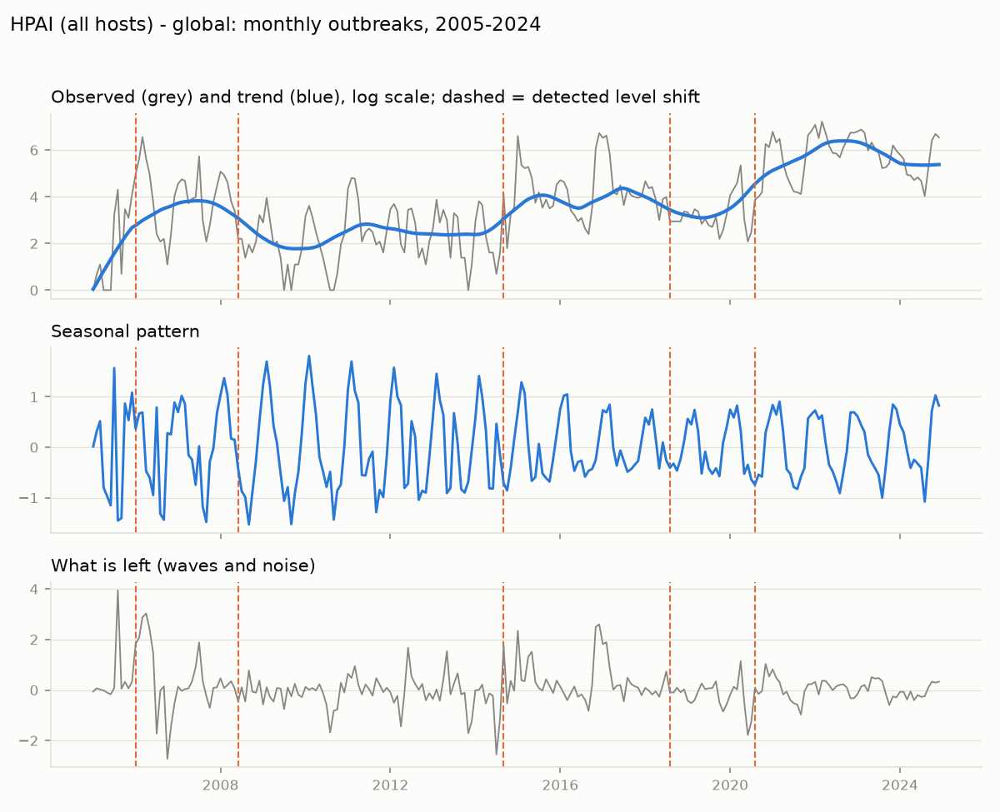
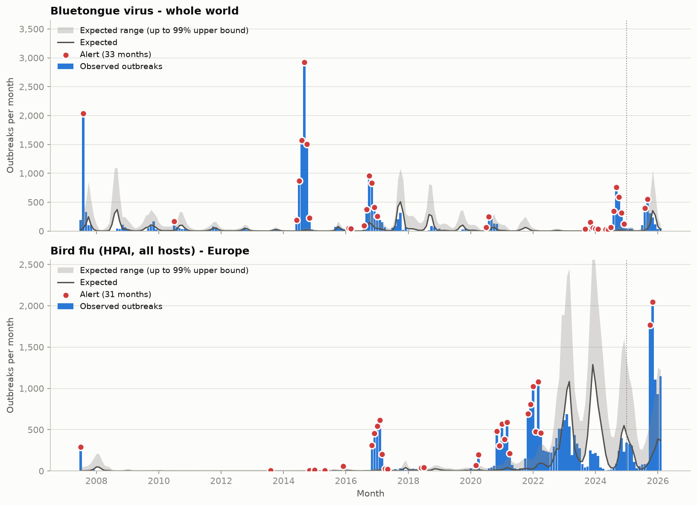
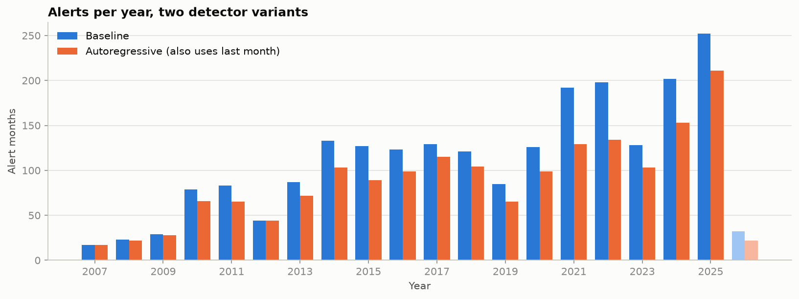
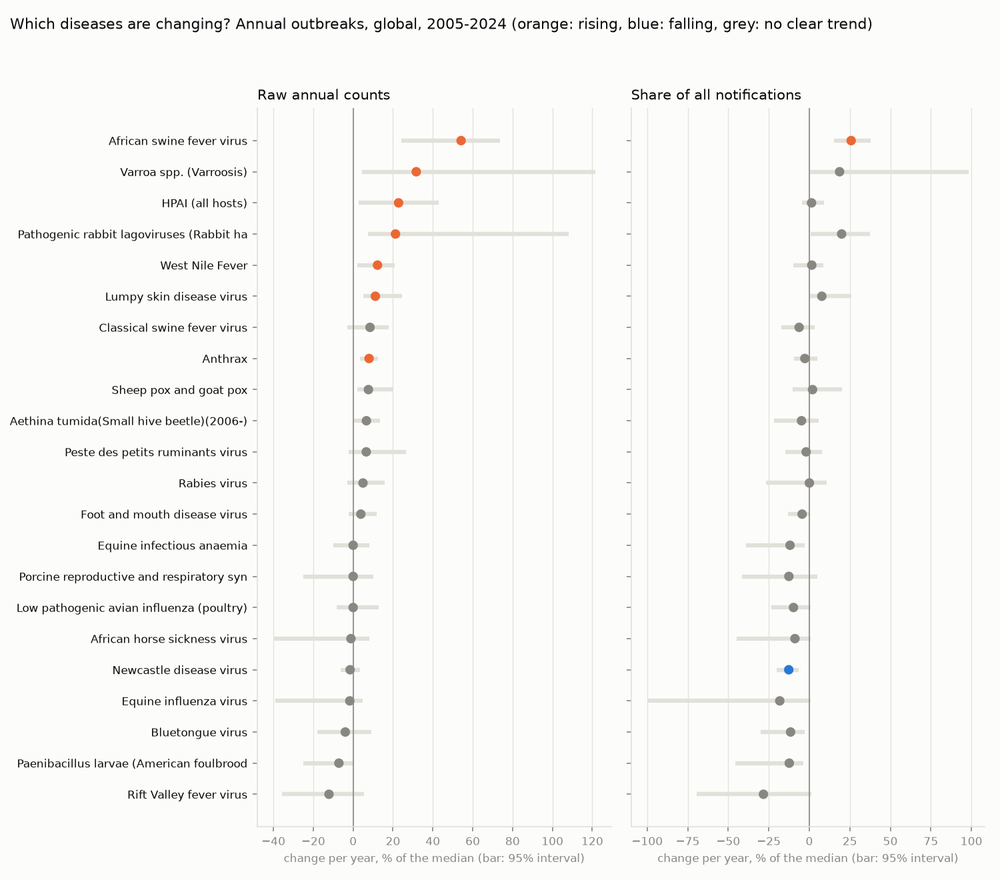
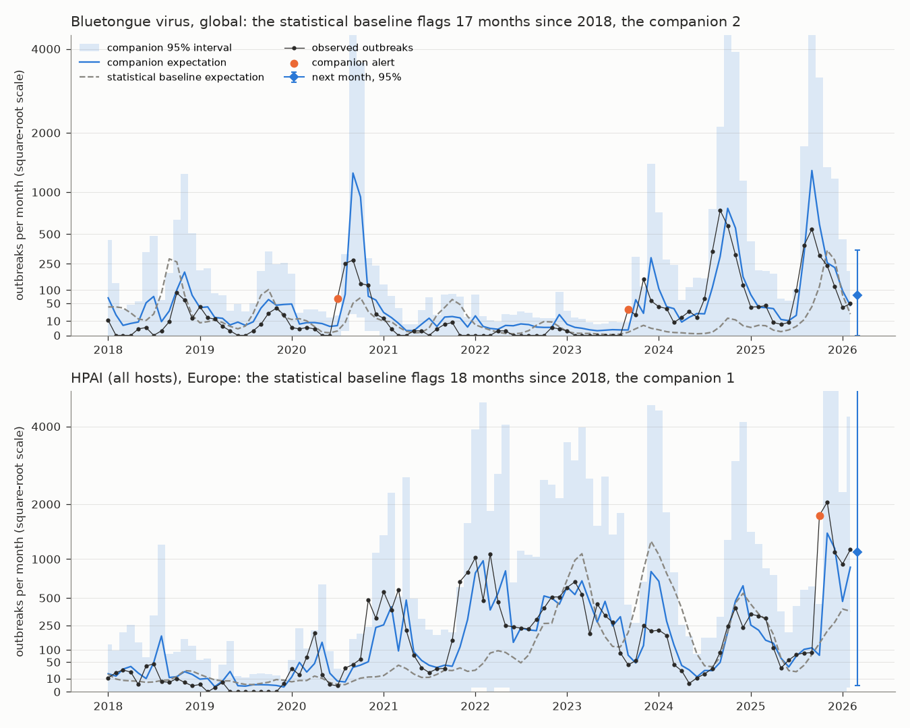
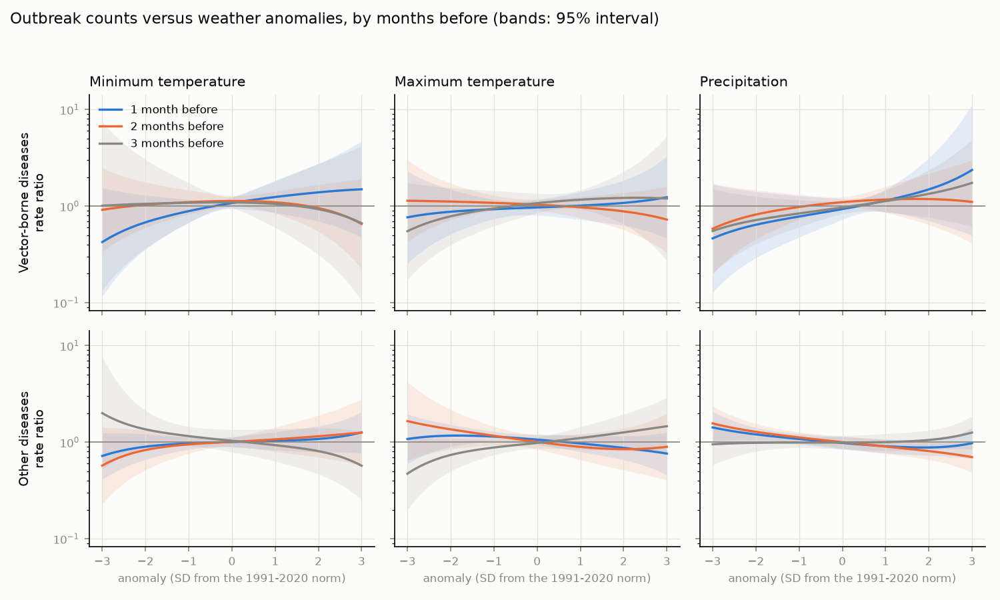

# Trends in animal disease occurrence: baselines, anomalies and weather in WAHIS notifications, 2005-2024

**WOAH Datathon, Topic 6.** Team: Latin Team. Version of 2026-10-24. Code and the numbers in this
report are reproducible from this repository (section 9), except the development diagnostics from earlier code
versions quoted in section 5.

> Data citation required by the WOAH data licence: World Organisation for Animal Health (WOAH)
> (2026) - WAHIS periodical extraction of early warning outbreak data. Retrieved on 2026-10-23.
> Data extracted by Latin Team.

---

## 1. Summary

The question of Topic 6 is what is *normal*, what is *expected* and what is a *significant variation*
in animal disease occurrence in WAHIS since 2005, whether the picture is linked to weather, and
whether the result can serve as an early warning signal. In short:

1. **Normal and expected** are defined per disease and area by a seasonal baseline that is refit
   every month on the previous five years, ignores one-off waves, and returns a full predictive
   distribution. Seasonality is disease specific: bluetongue peaks in October, HPAI in February,
   African swine fever (ASF) in July, West Nile fever in October (section 6.1).
2. **Significant variations** are months whose count is far above that distribution, with the false
   discovery rate controlled at 5 %, and a minimum size (at least 3 outbreaks and twice the expected
   count). The detector tests 465 outbreak series and produces 2,210 alert months grouped into 924 episodes. The
   largest episodes coincide with well documented epizootics (bluetongue in Europe, the 2020-22 HPAI
   wave, new world screwworm in Mexico, sheep pox and goat pox in Greece; section 6.2). A variant
   that models persistence flags shorter bursts; it is intended for onset detection, although onset timing
   was not evaluated separately.
3. **Trends are largely a reporting phenomenon.** 23 of 98 established disease series (global and
   regional) rise in raw annual outbreak counts, but only 4 series rise and 6 fall once each is expressed
   as a share of all notifications. African swine fever (ASF) is the only global disease growing clearly
   faster than overall reporting. The number of countries notifying events per month rose 2.2 times
   from 2005-09 to 2020-24, events 3.1 times and outbreaks 5.9 times (section 6.3).
4. **A pooled forecast adds value during waves.** A gradient-boosted model and an LSTM, scored on
   the same rows under a protocol and decision rule fixed in advance, beat the best statistical model
   by +0.73 and +0.87 in mean log score (2020-24), almost entirely in wave months. They supplement
   the alerts; they do not replace them because they cannot explain why a month is flagged. An
   "expected next month" companion table is provided (section 6.4).
5. **Weather adds very little.** Lagged counts carry almost all the predictive signal. Weather
   anomalies at lags of 1-3 months add nothing out of sample in linear or nonlinear (GAM) form. In
   sample the association of the whole weather block disappears once shared time trends are removed
   (placebo p = 0.20). One specific pattern survives a calibrated placebo test that corrects for having
   looked at 18 terms: wetter-than-usual months precede more outbreaks of vector-borne diseases one month
   later (rate ratio 1.48 per SD; placebo p = 0.003, family-wise 0.017). Its out-of-sample gain is
   negligible (+0.003 log score per month; section 6.5).
6. **Early warning is only partly supported.** On final-vintage counts the methods flag a surge in the
   month it happens and forecast one month ahead; real-time reporting delay was not tested. Evidence
   for longer lead times, for example from weather or from neighbouring countries, was not found or
   not tested (section 7).

## 2. Question, scope and definitions

**Scope.** All WAHIS immediate notifications and follow-up reports in the organisers' INFUR extract,
2005-01-01 to 2026-07-02, global and by WOAH region, with weather from WorldClim. The analysis window
for trends and weather is 2005-2024 (the WorldClim series ends in December 2024); 2025 to early 2026
is a disease-only holdout.

**Terms that are easy to confuse.**

* *Outbreak*: a unique `Outbreak_id`. *Event*: a disease occurrence in a country, which contains many
  outbreaks (`epi_event_id`). *Report*: one notification or follow-up, which can repeat outbreaks.
* *INFUR* data are immediate notifications and follow-ups of exceptional events, **not** endemic
  six-monthly reporting. Every statement about "occurrence" is a statement about *notified* events.
* *Normal / expected*: the central part of a predictive distribution computed from the past only.
  *Significant variation*: a month with a small upper-tail probability under that distribution.
  *Association* with weather is not *prediction*; both are tested separately.

## 3. Data and preparation

| Source | Content | Use |
| --- | --- | --- |
| WAHIS INFUR extract | 223,773 rows (one per report x outbreak x species), 188,464 outbreaks, 6,625 events, 147 disease names (248 WAHIS disease ids), 190 countries | counts, locations, dates |
| WorldClim 2.1 historical monthly weather (CRU-TS 4.09 downscaled), 1990-2024, 10 arc-min | tmin, tmax, precipitation | weather anomalies at outbreak locations |

Decisions that change results (all are logged in the README with their reasons):

* **Disease keys.** `disease_id` is not a clean key (bluetongue appears under 20 different ids, for example 29, 32 and 46). Series are
  keyed by disease name; the three HPAI categories (poultry, non-poultry, bovine) are merged so the
  2017 list change does not look like a new disease.
* **Duplicates.** 16,234 outbreaks appear in more than one report; counts use unique outbreak ids.
* **Reporting delay.** The median delay from outbreak start to report is 15 days, the 90th percentile
  104 days, the 95th 198 days. Months within 4 months of the extraction date are excluded from scoring
  (scoring ends February 2026).
* **Locations.** All outbreaks have coordinates; 20 % are flagged approximate by WOAH. 546
  outbreaks fell on ocean cells and were moved to the nearest land cell (at most 70 grid cells).
* **Weather anomalies.** Anomaly = monthly value minus the 1991-2020 mean of the same calendar month in
  the same cell (temperature), or a z-score (precipitation). The z-score is clipped at +/-5: 2,163 of
  13.9 million cell-months (0.016 %) exceeded it (43 % of them in 1990, outside the analysis window;
  within 2005-2024, 84 % in 2021-2024), consistent with cells whose reference precipitation barely
  varies, so the denominator is close to zero. The resolution is
  10 arc-minutes because CRU-TS is 0.5 degrees natively.
* **Country exposure.** A country's weather exposure is the mean anomaly over the grid cells where it
  has ever notified an outbreak (median 49 cells per country): the footprint of notification, not the
  whole territory.

The data are strongly concentrated: Europe is about 70 % of rows, and three diseases (ASF, HPAI,
bluetongue) are 76 % of outbreaks (ASF alone 39 %). Animal counts (`cases`, `dead`, `susceptible`)
are unreliable (51 % of rows have no `susceptible` value at all), so all analyses
use counts of outbreaks and events.

## 4. Methods

### 4.1 Series

A series is the monthly number of outbreaks (intensity) or of new events (sparser, less sensitive
to reporting style) for one disease in one area: global, one of five WOAH regions, or one country.
Series with at least 30 outbreaks (10 events) are kept: 486 outbreak series (61 global, 106 regional,
319 country) and 291 event series.

### 4.2 Anomaly detector

For each series and month *t*, using only data before *t*:

1. A log-linear quasi-Poisson model is fitted on the trailing 60 months (at least 24): intercept,
   optional linear trend and 0-2 annual harmonics. Complexity follows the information in the
   window: the number of non-zero months counts as well as the total, because a window with two
   non-zero months cannot support a trend and a seasonal cycle.
2. **Season screen.** Each past month is compared with the median of the same season (calendar month
   +/- 1) in the window; months above three times that median are down-weighted. A peak that recurs
   stays in the baseline, a one-off wave does not. Farrington reweighting (standardised residuals
   above 2.58) and one refit follow. An unstable fit is simplified step by step.
3. The predictive distribution of month *t* is negative binomial with variance
   `phi * mu + mu^2 * se(eta)^2`: overdispersion plus parameter uncertainty.
4. The upper-tail probability is converted to a Benjamini-Hochberg FDR across all tests of a metric
   (q = 0.05). An **alert** also needs at least 3 outbreaks (2 events) and observed/expected >= 2.
5. Consecutive alert months (gap of at most one month) form an **episode**. First-ever and
   long-absent occurrences have no baseline and are listed separately (`first_occurrence`,
   `reemergence`).

A second variant (`ar1`) adds the log of last month's count as a regressor (log-linear
autoregression). It flags a month only if it is a *surprise given last month*, which is meant to
suit onset detection (timing was not evaluated separately; in the simulation both variants detect in the
same month); the plain baseline keeps a wave flagged for its whole duration. The lag term is only fitted
where the window has at least 12 non-zero months and 36 months of history, so in 51 % of tested months
`ar1` is identical to the baseline.

### 4.3 Trends

Per global and regional series, 2005-2024: robust STL decomposition of log(1+count) (trend and
seasonal strength, peak month); Mann-Kendall test and Theil-Sen slope on annual totals, FDR adjusted
across series, for diseases active in at least 10 of the 20 years; the same tests on the disease's
share of all notifications in its area, which removes the general growth in reporting; PELT change
points on the de-seasonalised series with a BIC-style penalty scaled by the STL remainder variance.
The same tools are applied to reporting intensity (all diseases pooled).

### 4.4 Pooled forecast models

A pooled LightGBM (Poisson objective) and a pooled LSTM (24 months of log counts, calendar and static
features, negative-binomial output) predict the next month for all series in one model per refit.
Protocol, fixed in advance: rolling origin, yearly refit, test years 2018-2026, one-step-ahead, all
scalers and series statistics from training months only, the last 12 training months held out for early
stopping and dispersion. The metric is the mean negative-binomial log score on the 24,635 rows every
model scores; differences use a paired bootstrap that resamples whole series (2,000 draws). The
decision rule (written down before scoring): a model is a *supplement* if its gain over the best
statistical model has a 95 % interval above zero in 2020-24, is not negative in 2025-26 and its
residual sd is within 0.9-1.3; it is a *replacement* only if it also does not lose on surge rows, sparse
series and short histories and does not lose on interpretability and reproducibility needs. The
"explains why a month is flagged" criterion is a judgement, not a measurement.

### 4.5 Weather analysis

* **Pooled negative-binomial regressions** on the 319 country series, same protocol and scoring,
  with lagged counts, series history, a reporting-intensity proxy and disease-specific seasonality,
  then the same model plus tmin, tmax and precipitation anomalies at lags 1-3 (lag at least 1 month; the
  publication delay of the weather product is ignored), with separate coefficients for vector-borne diseases (bluetongue, West Nile
  fever, lumpy skin disease, Rift Valley fever, epizootic haemorrhagic disease, African horse
  sickness, Schmallenberg), and one hypothesis-focused model with precipitation only, vector-borne
  only. A ridge-stabilised IRLS fit is used; errors are cluster-robust by country.
* **Association test.** In-sample likelihood-ratio statistic of the weather block, compared with a
  **placebo** distribution in which whole calendar years of each country's weather are shuffled (this
  keeps seasonality and within-year autocorrelation and breaks the alignment with disease; 300
  shuffles), with and without calendar-year fixed effects. The same shuffles give a placebo p-value for each
  coefficient, and a family-wise version that compares each coefficient with the largest standardised
  coefficient among all 18 terms in every shuffle.
* **GAM.** Each anomaly and lag enters as a penalised cubic spline (7 basis functions, second-difference
  penalty), separately for vector-borne and other diseases; the penalty strength is chosen per test year on
  an inner validation block.

## 5. Validation

| Check | Result |
| --- | --- |
| Unit tests (27) | IRLS equals a reference GLM; false-alarm rate on a simulated seasonal null below 2 % at nominal 1 %; a 6x outbreak is detected; a one-off wave inflates next year's expectation 391-fold without the season screen and 1.07-fold with it (medians over 20 simulated series; the test asserts a ratio below 1.5); sparse windows no longer explode; pooled models cannot see the future; NB fits recover known coefficients; the placebo shuffle preserves each country's data |
| Simulation benchmark | 720 series with historical waves: 540 with one injected outbreak of known size, 180 outbreak-free controls (below) |
| Rolling-origin forecasts | one-step-ahead, only past data, 2018-2026 |
| Residual diagnostics | Dunn-Smyth residuals, Ljung-Box (12 lags) per series |

**Simulation (mean over three baseline levels).**

| Detector | Detected, 2.5x outbreak | 4x | 8x | False alerts per 100 outbreak-free months |
| --- | --- | --- | --- | --- |
| no season screen | 0.33 | 0.61 | 0.89 | 0.46 |
| baseline (screened) | 0.48 | 0.79 | 1.00 | 0.57 |
| ar1 | 0.46 | 0.77 | 1.00 | 0.56 |

The screen raises detection by 15 points at 2.5x and 18 at 4x (11 at 8x) for 0.11 more false alerts per
100 outbreak-free months; the total rate of 0.57 per 100 months is about one false alert per 15 years per
series. The simulated series have no persistence, so they do not show what the
autoregressive term gains; the real-data diagnostics do (section 6.2).

Two defects were found during development and fixed: a baseline that predicted the previous wave again
the next season (expected about 4,050 outbreaks for August 2015 when 2 were observed), and fits on sparse
windows that diverged (expected counts of 4.9e8 in about 0.5 % of tests). Both now have regression tests;
the pre-fix figures come from earlier code versions and cannot be regenerated, but the effect is reproduced
by the unit tests and by the "no season screen" row above.

## 6. Results

### 6.1 What is normal and expected

*Figure 1. HPAI (all hosts), global monthly outbreaks. Trend (blue), seasonal pattern, remainder;
dashed lines are detected level shifts.*

| Disease (global) | Outbreaks 2005-24 | Trend strength | Seasonal strength | Peak month |
| --- | --- | --- | --- | --- |
| African swine fever | 56,507 | 0.92 | 0.18 | July |
| HPAI (all hosts) | 35,163 | 0.75 | 0.47 | February |
| Bluetongue | 21,886 | 0.43 | 0.43 | October |
| Foot-and-mouth disease | 4,969 | 0.46 | 0.32 | February |
| Lumpy skin disease | 4,136 | 0.58 | 0.29 | July |
| Classical swine fever | 2,263 | 0.66 | 0.27 | July |
| Rabies | 2,006 | 0.64 | 0.00 | September |
| New world screwworm | 1,503 | 0.88 | 0.26 | July |
| West Nile fever | 1,411 | 0.22 | 0.54 | October |
| Newcastle disease | 1,317 | 0.26 | 0.30 | January |

Schmallenberg virus (3,506 outbreaks in one nine-month wave in 2011-12) has no row: too few active years.
Strengths are the share of variance explained by that component (0-1). ASF is dominated by trend and
waves rather than season; West Nile fever, HPAI and bluetongue are the most seasonal. The expected
value for a month is therefore the seasonal level, adjusted by the recent trend, with a wide
negative-binomial band (counts are strongly overdispersed: bluetongue peaks at 2,926 outbreaks in one month
against a monthly mean of about 92).

### 6.2 Significant variations

*Figure 2. Observed outbreaks (bars), expected count (line), 99 % upper bound (band) and alert months
(red). Dotted line: end of the weather period (2024-12).*

On the 465 outbreak series with at least one tested month (486 are eligible; 45,242 tested months, scoring
2007-01 to 2026-02):

| | baseline | ar1 |
| --- | --- | --- |
| Alert months (2007-2024 / 2025-26 holdout) | 1,926 / 284 | 1,507 / 233 |
| Episodes | 924 | 949 |
| Alert months per episode (mean, 90th percentile) | 2.4, 5 | 1.8, 4 |
| Series failing Ljung-Box on residuals (p < 0.05) | 50 % | 43 % |
| Sd of Dunn-Smyth residuals, 2007-2024 (1 = calibrated) | 1.50 | 1.40 |

Most alerts are in country series (1,126), then regional (659) and global (425). Events are sparser: 26
alerts (baseline) and 15 (ar1) on 27,600 tested months. Alerts per year grow from 23 in 2008 to 202 in
2024 (252 in 2025). Both more testable series (tested months per year: 1,153 in 2008, 3,110 in 2024)
and a higher alert rate contribute: 17-21 alerts per 1,000 tests in 2008, 2009 and 2012, 29-73 per year
from 2014 (65 in 2024, 73 in 2025); the rate is not monotone. Part of the rise follows the growth in
reporting (section 6.3).

The ten largest global episodes (by excess count) and where they happened:

| Disease | Episode | Peak monthly count | Main countries (outbreaks in the episode) |
| --- | --- | --- | --- |
| Bluetongue | 2014-06 to 2014-11 | 2,926 | Greece 2,682, Bulgaria 1,353, Romania 1,113 |
| HPAI | 2021-11 to 2022-04 | 1,356 | France 1,442, Germany 842, Netherlands 463 |
| HPAI | 2025-10 to 2025-11 | 2,271 | Germany 2,216, France 342, United Kingdom 327 |
| HPAI | 2020-11 to 2021-03 | 879 | Germany 706, France 506, Korea 353 |
| Bluetongue | 2016-08 to 2017-01 | 959 | France 1,668, Italy 417, Serbia 416 |
| HPAI | 2016-11 to 2017-02 | 829 | France 486, Korea 361, Hungary 297 |
| New world screwworm | 2024-10 to 2025-05 | 828 | Mexico 1,986, Nicaragua 208, Honduras 121 |
| Bluetongue | 2024-05 to 2024-12 | 762 | Denmark 891, Austria 294, France 236 |
| Bluetongue | 2007-08 | 2,038 | Germany 1,046, Belgium 764, Luxembourg 115 |
| Sheep pox and goat pox | 2025-04 to 2026-01 | 390 | Greece 1,721, Bulgaria 189, Romania 27 |

These match documented events (the north-western European bluetongue serotype 8 epizootic of 2006-07,
the 2020-22 HPAI epizootic, the northward spread of screwworm in 2024-25, the 2025 sheep pox and
goat pox outbreaks in Greece and Bulgaria). This is a plausibility check, not a validation: no labelled
ground truth exists, which is why the simulation (section 5) is the evidence for the detector's error
rates.

*Figure 3. Alert months per year. The baseline keeps a whole wave flagged; the autoregressive variant
flags shorter bursts.*

**Known weakness.** After a multi-year wave the baseline can still over-predict: a wave that recurs in
several years counts as normal (Europe HPAI, December 2023: about 1,288 expected, 208 observed; Figure 2).
Among tested months with an expected count above 20, 12 % had an observed count below a tenth of
expected (29 % when the season screen is switched off in the current code). Alerts on very small counts, where about zero was expected,
are weak signals and should be read together with the `first_occurrence` list.

### 6.3 Trends

*Figure 4. Theil-Sen slope per year, % of the median, for the 22 largest diseases (bars: 95 %
interval). Left: raw annual counts. Right: share of all notifications. Orange rising, blue falling.*

* Raw counts: of 98 established outbreak series (40 global, 58 regional), 23 rise and 1 falls. Share of
  notifications: 4 rise and 6 fall. ASF is the only global disease rising clearly faster than reporting
  (+26 % of its median share per year, q < 0.001); ASF in Europe (+21 %), classical swine fever in
  Asia-Pacific (+114 %) and rabies in Africa (+42 %) rise regionally; Newcastle disease falls globally
  (-13 % per year). For events, HPAI (+8.6 % per year)
  and ASF (+18 %) rise; foot-and-mouth disease, Newcastle disease and classical swine fever fall in share.
* Countries notifying per month change level in 2006-02, 2016-06, 2020-09 and 2024-07 (the events series
  gives 2006-02, 2016-06, 2020-10 and 2024-08; both fitted through 2026-02). Between 2005-09 and 2020-24 the
  average countries notifying per month rose from 11.8 to 25.8, events from 13.2 to 41.7 and outbreaks from 218
  to 1,289 per month (`figures/reporting_intensity.png`). A change point in a disease series that coincides
  with these dates may be reporting rather than disease.
* Because ASF and HPAI dominate the denominator, shares of other diseases fall mechanically; the events
  metric is less affected.

### 6.4 Forecast models and the companion

| Gain in mean log score over `ar1` (95 % CI) | GBM | LSTM | Residual sd |
| --- | --- | --- | --- |
| 2020-2024 | +0.73 [+0.38, +1.22] | +0.87 [+0.51, +1.36] | 1.03 (statistical models 1.45-1.60) |
| 2025-2026 holdout | +0.97 [+0.49, +1.66] | +1.11 [+0.63, +1.80] | 1.03-1.07 |

* 94 % of the LSTM's gain over the baseline is in the 10 % of months with a count at least three times
  expected; on ordinary months the LSTM gains +0.02 and the GBM loses 0.07 (0.14 in 2025-26), and the GBM also
  loses at high volume (-0.23 [-0.43, -0.01]). HPAI and bluetongue supply
  about 70 % of the gain. Gains hold for sparse series (+0.6 to +1.1 for the LSTM) and short histories
  (+0.56), and in a bootstrap by disease instead of by series.
* The statistical baseline is a deliberate "normal" reference that excludes one-off waves, so log score
  favours a forecaster during waves by construction. By the decision rule written down before scoring, both pooled models are
  supplements, not replacements.
* The LSTM beats the GBM by +0.14 [+0.11, +0.16] and is adopted into the companion; an ensemble of the
  two is not better than the LSTM.
* **Companion** (`reports/tables/companion_forecast.csv`): for 481 series, the expected count for 2026-03 with 80 %
  and 95 % intervals from the GBM and the LSTM. It is the mean of the predictive distribution given counts
  through February 2026; a wave under way is expected to continue, so it is **not an alert threshold**.
  Companion alerts using the same rule as the detector (145 since 2018 against 1,336 for the baseline and
  1,020 for ar1; the alerts and Figure 5 use the GBM) overlap with about 10 % of baseline alerts: the rest are
  mostly months in or right after a wave (79 % had at least 3 outbreaks the month before, 60 % were already in
  alert). The GBM's 80 % intervals cover 94 % of months in 2020-24 and 88-92 % for expected counts above 10, so
  they are too wide for large series, and for the largest series the two
  models differ by up to a factor of 2.5 (global foot-and-mouth disease: GBM 521, LSTM 211; global HPAI: GBM
  1,211, LSTM 688, last month 1,315).

*Figure 5. Observed, baseline expectation and companion expectation with its 95 % band, for global
bluetongue and Europe HPAI.*

### 6.5 Weather

Gain in mean log score (2020-24, country rows) relative to the counts-only pooled NB regression:

| Model | Gain [95 % CI] |
| --- | --- |
| counts only, versus `ar1` | +0.99 [+0.40, +1.89] |
| counts only, versus GBM | -0.049 [-0.081, -0.018] |
| + linear weather, lags 1-3 | -0.002 [-0.004, 0.000] |
| + weather, separate for vector-borne diseases | -0.001 [-0.005, +0.002] |
| + GAM smooth weather curves | -0.005 [-0.011, -0.000] |
| precipitation only, vector-borne only (exploratory) | +0.003 [+0.001, +0.005]; vector-borne rows +0.006 [-0.003, +0.015] |

* **Counts dominate.** A transparent pooled NB regression is within 0.05 of the GBM and well calibrated
  (residual sd 0.97).
* **Association in sample depends on time effects.** Without year effects the weather block is
  "significant" (placebo p = 0.007); with calendar-year fixed effects, which remove the shared trend
  of warming and reporting growth, it is not (placebo p = 0.20). The likelihood-ratio statistic under the
  placebo has a median of 96-136 on 18 degrees of freedom, and the cluster-robust Wald test (p = 2e-16)
  is far more confident than the placebo; neither naive test is relied on.
* **One pattern survives.** For vector-borne diseases, wetter-than-usual months precede more outbreaks one
  month later: rate ratio per SD of 1.48 (nominal 95 % interval 1.20 to 1.82, from the cluster-robust test and
  probably too narrow). The placebo test specific to this term gives p = 0.003 (none of 300 shuffles is as
  large) and p = 0.017 against the largest of all 18 terms in each shuffle, so it survives correction for
  having looked at 18 terms. The three-month lag (rate ratio 1.28) does not (placebo p = 0.06, family-wise
  0.64), and neither does any temperature term. The effect is biologically plausible (rainfall and vector
  breeding), but it was found after looking at the results, the GAM curve is flatter (rate 0.93 at 0 SD to 1.14
  at +1 SD, with wide bands) and the out-of-sample gain is negligible.
* **No thresholds.** The GAM curves are smooth and nearly linear (about 1.9 effective degrees of freedom
  per curve, where 1 is a straight line), and the model is no better out of sample.

*Figure 6. Rate ratio of outbreak counts against weather anomalies one to three months earlier (bands: 95 %
interval), vector-borne diseases (top) and others (bottom).*

## 7. Interpretation and practical use

**How a WOAH analyst can use the outputs.**

* *Screening.* `reports/tables/alerts_outbreaks*.csv` and `episodes_outbreaks*.csv` list the series and
  months that are unusual for that disease and area, with the observed and expected count. The `baseline`
  list shows how long a variation lasted; the `ar1` list shows bursts that were a surprise given the previous
  month (it equals the baseline in about half of the tested months, and onset timing was not evaluated
  separately). Read alerts with
  `emergence_*.csv`, which lists first-ever and re-appearing occurrences that a baseline cannot judge.
* *Planning.* `companion_forecast.csv` gives the expected next-month count with an interval for 481
  series; a large forecast with a high last-month p-value flags a wave that is probably continuing.
* *Reading trends.* Report share-adjusted trends next to raw ones, and treat any change point near a
  reporting change date (2006, 2016, 2020, 2024) with caution. ASF is the clearest case of a real rise
  relative to reporting.
* *Seasonal readiness.* The peak months in section 6.1 give the seasons in which surveillance is most
  likely to meet bluetongue (autumn), HPAI (winter) and West Nile fever (autumn).

**What is and is not supported as early warning.** On final-vintage counts the detector flags a surge in the
month it occurs, and the companion forecasts the next month, so one month of lead time exists for waves
already in progress. In real time the current month is still incomplete (median reporting delay 15 days; one
outbreak in ten takes more than 104 days), and a delay-aware version was not tested.
Weather lags of one to three months add almost nothing, and neighbouring-country spread, the most
plausible source of longer lead times for transboundary diseases, was not tested. Calling the result
an early-warning *system* for pre-emptive alerts would go beyond the evidence.

## 8. Limitations

* Notified events only. Reporting intensity, surveillance effort, trade and political context are
  confounded with disease occurrence. Europe is about 70 % of the data, so "global" results are
  largely European; counts of the three dominant diseases drive pooled results.
* No true absences: a month without a notification is a zero, not proof of no disease.
* Recent months are incomplete because of reporting delay (four months are excluded); counts are the
  final vintage, not as first reported. All detection results are on final-vintage counts by outbreak start
  month; a real-time system would see incomplete counts for the latest months.
* The baseline treats waves that recur over several years as normal, so it can be insensitive the
  following year. Alerts depend on fixed choices (window of 60 months, FDR 5 %, minimum size) that
  were not tuned to outcomes but are not unique.
* Weather is a country-footprint average of 0.5-degree anomalies at monthly resolution and ends in 2024;
  local microclimate and humidity-type variables are out of reach (only tmin, tmax and precipitation are available).
  The weather results use observational data and test few lags.
* The pooled forecast models were scored one step ahead; no multi-month horizon was evaluated. The
  GBM's intervals are too wide for large series and the two models can disagree by a factor of up to 2.5.
  Hierarchical series (global, region, country) are dependent; the bootstrap by disease widens
  the intervals without changing the conclusions.
* The vector-borne rainfall pattern was identified after seeing the data and should be confirmed on new
  data before it is relied on.

## 9. Reproducibility

* **Code and environment.** Python 3.13 and `uv`: `uv sync` reproduces the environment from `uv.lock`;
  `uv sync --extra deep` additionally installs PyTorch (about 500 MB), needed only to retrain the LSTM.
* **Data.** `uv run python -m t6.fetch` downloads the WAHIS extract from the organisers' site and the
  WorldClim rasters (about 2 GB); `data/` is not committed. If the organisers' URL changes, place
  the workbook at `data/raw/infur/infur_20260702.xlsx`.
* **Run order and cost** (approximate, measured during development on a 12-core Windows machine): fetch (download time), ingest (a minute or two),
  climate (about 70 s), exposure (seconds), detect (about 80 s), trends (about 3 min), simulate (about
  3 min), deep (about 10 min with the LSTM; seconds for the GBM), compare (about 15 s), companion
  (seconds with the GBM). nbmodels and gam take 10-30 minutes each, dominated by the placebo tests
  (`--skip-placebo` omits them). The commands are listed in the README.
* **Clean-clone check.** A fresh clone of the repository, installed without PyTorch and run from the raw
  downloads, completed every step (about 35 minutes with the placebo tests skipped; the GAM step alone
  took 20), passed all 27 tests and reproduced the detector, trend, simulation, regression and GBM tables
  identically; only the LSTM columns, which need PyTorch, were absent.
* **Determinism.** Seeds and thread counts are fixed. Rerunning the GBM and an LSTM fit gave bit-identical
  predictions on this machine; the placebo tests use fixed seeds.
* **Tests.** `uv run pytest` runs 27 tests (about 2 minutes).
* **Documentation.** Every decision that changes results is in the README decision log; the model
  benchmark protocol and the adoption rule are in `reports/dl_evaluation.md`; all result tables are in
  `reports/tables/`; exploratory charts are in `charts/` and `notebooks/01_eda.html`.
* **This report** is built from `reports/technical_report.md` into `technical_report.html` (self-contained, images
  embedded) and `technical_report.pdf` with `uv run python -m t6.build_report` (the PDF step needs Edge or Chrome).
* **Licence and attribution.** The WOAH citation above applies to all outputs derived from WAHIS data.

## References

* Benjamini Y, Hochberg Y (1995). Controlling the false discovery rate. *J R Stat Soc B* 57:289-300.
* Cleveland RB et al. (1990). STL: a seasonal-trend decomposition procedure based on loess. *J Off Stat* 6:3-73.
* Dunn PK, Smyth GK (1996). Randomized quantile residuals. *J Comput Graph Stat* 5:236-244.
* Eilers PHC, Marx BD (1996). Flexible smoothing with B-splines and penalties. *Stat Sci* 11:89-121.
* Farrington CP, Andrews NJ, Beale AD, Catchpole MA (1996). A statistical algorithm for the early
  detection of outbreaks of infectious disease. *J R Stat Soc A* 159:547-563.
* Killick R, Fearnhead P, Eckley IA (2012). Optimal detection of changepoints with a linear
  computational cost. *J Am Stat Assoc* 107:1590-1598.
* Noufaily A et al. (2013). An improved algorithm for outbreak detection in multiple surveillance
  systems. *Stat Med* 32:1206-1222.
* Fick SE, Hijmans RJ (2017). WorldClim 2: new 1-km spatial resolution climate surfaces for global land
  areas. *Int J Climatol* 37:4302-4315.
* Harris I et al. (2020). Version 4 of the CRU TS monthly high-resolution gridded multivariate climate
  dataset. *Sci Data* 7:109.
